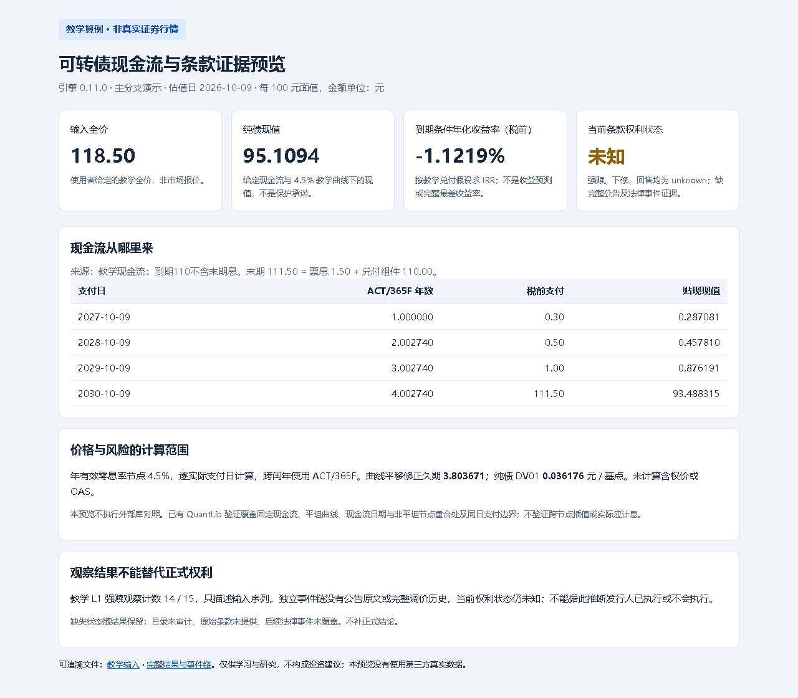

# 可转债现金流与条款研究：详细使用说明

当前安装与教学入口见[首页](README.md)，资料准备见[BEGINNER](BEGINNER.md)。历史下载说明见[版本记录](CHANGELOG.md)。以下保留具体命令、方法、样本和限制，历史案例按各自日期阅读。

## 实际结果示例

下面是程序生成的**教学结果，不是真实行情**。估值日为 2026-10-09，金额按每 100 元面值。

| 结果 | 教学数值 | 怎么理解 |
| --- | --- | --- |
| 输入全价 | 118.50 元 | 由样本给定，不是市场报价 |
| 纯债现值 | 95.1094 元 | 按样本现金流及 4.5% 教学曲线贴现，不是兑付保证 |
| 税前到期条件年化收益率 | −1.1219% | 假设现金流兑现时的计算结果，不是收益预测 |
| 当前条款权利 | 未知 | 观察计数不能代替完整公告和合同依据 |



截图对应[HTML 报告](docs/preview/report.html)、[教学输入](docs/preview/input.json)和[完整结果](docs/preview/result.json)。也可查看[交互报告](docs/interactive-preview/report.html)，筛选已有诊断、比较已计算的曲线情景并另存选择；切换页面选项不会重新定价。


## 能做什么，暂不支持什么

| 能做什么 | 使用前提或限制 |
| --- | --- |
| 计算纯债现值、税前／税后收益率和给定退出条件下的收益率 | 支付日期、含息口径和税额要明确；部分退出情景不等于完整最差收益率 |
| 计算转股价值、溢价率、久期、DV01、凸性及曲线变动结果 | 使用声明清楚的零息曲线；非平坦曲线风险不能直接当作单一收益率久期 |
| 筛选给定债券、汇总给定持仓 | 需要完整计算输入，不能拿缺字段的行情快照直接定价 |
| 展示行情资料、公告线索和转股价变化记录 | 保留数据日期、来源与缺口；没找到公告不等于没有风险 |
| 检查本地 PDF 的摘要、指定页码和字段，保存核对档案 | 字面匹配不能认证原件来源或完整法律含义；原文不随包分发 |
| 按历史有效转股价做条款观察计数 | 缺调价链、交易日或停牌处理依据时，正式结论保持未知 |

**暂不支持**完整含权理论价、OAS、隐含波动率、发行人决策概率、交易回测或交易执行。真实信用曲线、实际应计息和最终到账也需要另行核实。强赎价格条件满足，不代表发行人已经决定或执行赎回。

金额、日期、净全价和含末息拆分的详细说明统一见[使用与验收详解](docs/USAGE_AND_EVIDENCE.md)；计算方法见[固定收益方法卡](docs/FIXED_INCOME_METHOD_CARDS.md)。


## 独立使用与项目关系

本仓提供独立 **Python 命令行工具和库**及 [Skill 调用指引](SKILL.md)；包名是 `convertible-bond-engine`，命令名是 `cb-engine`。例如，`cb-engine examples/demo.json` 会输出 JSON。不需要安装 research-workbench 才能运行。

工作台可以选择调用本引擎做固定现金流计算。双方已经验证的相同口径、不能直接比较的字段及历史调用记录见[工作台调用说明](docs/BOUNDED_WORKBENCH_BRIDGE.md)。公司经营分析和综合判断由工作台负责，本引擎不会据资料卡给出交易指令。

| 额外用途 | 安装前提 |
| --- | --- |
| 离线计算、教学预览和情景实例 | 核心没有第三方运行依赖 |
| 显式联网查询行情 | `python -m pip install ".[market]"`，接口不保证持续可用 |
| 读取本地 PDF 核对字段 | `python -m pip install ".[evidence]"`，扫描件需另行人工复核 |
| 可选 QuantLib 数值对照 | 在独立验证环境安装 `QuantLib==1.43`，不是核心必需项 |

这些是按需安装的普通第三方组件，不会自动安装其他自家专业库。联网与 PDF 操作的命令见使用详解；核心输出缺证据时不会自动换口径或填零。


## 验证、来源和许可

- [独立安装验收](docs/STANDALONE_ACCEPTANCE.md)：单仓 wheel、新虚拟环境、模块来源、实际输出和失败例；不等于新系统、自然语言发现或视觉验收。
- [外部数值对照](docs/EXTERNAL_CROSSCHECK.md)：QuantLib 固定现金流的实际范围；FinancePy 未运行，缺库或未执行不算通过。
- [数据与交付契约](docs/DATA_AND_DELIVERY_CONTRACT.md)：职责、版本、数据入口、真实样本范围及剩余缺口。CI 通过不认证真实资料或投资有效性。
- [后续路线](ROADMAP.md)与[更新记录](CHANGELOG.md)：已完成与后续能力分别说明。

原创代码及有权授权的原创说明采用 [MIT 许可](LICENSE)。第三方库、公告、行情及引用材料的权利独立于代码许可，详见[第三方范围清单](THIRD_PARTY_NOTICES.md)。仅供学习和研究，不构成投资建议；使用前请阅读[免责声明](DISCLAIMER.md)，结合来源、假设和未核事项判断结果。


## 历史快照复跑与示例入口

`--quality-as-of` 默认是北京时间今日，用来评估资料截至今天的陈旧程度，不自动跟随 `quote_time`。复跑历史快照时须显式指定质量评估截止日，并核对规则上下文的代码与该日一致；收益率底稿的代码及估值日另须与行情快照匹配。

```powershell
python -m cbengine.cli examples/analysis-market-demo.json --analysis-input examples/analysis-demo.json --quality-as-of 2026-10-09
```

这是教学收益率情景，不是当日真实行情。`analysis-demo.json` 是附加底稿，不能直接交给 `preview`。全部示例的类型和入口见[示例索引](examples/README.md)。年有效收益率由现金流IRR求得；ACT/365F表示计年方式，并不表示单利年化。


## 自然语言使用

向已注册本仓 Skill 的助手直接提问。助手整理输入、调用计算并先回答能确定的部分，再解释依据和缺口；无需安装工作台。新增指引自 v0.12.3 随包提供；更早的发行包保持原样。


## 验证范围

源码教学启动、软件环境查询和安装后教学入口分别验证；软件就绪不等于真实资料已取得。中文问答需要助手按本仓Skill准备已声明输入，没有宣称任意自然语言自动发现或全市场数据闭环。旧报告、历史tag与案例证据保留。


HTML报告增加“指标怎么读、金额怎么核”，先看结论和缺口，再展开口径。见 [REPORT_GUIDE.md](REPORT_GUIDE.md)。
